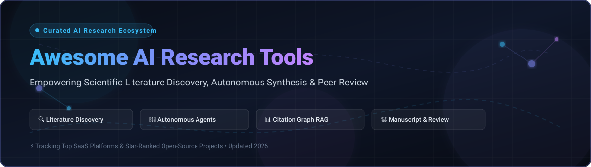

  

# 🚀 Awesome AI Research Tools

  
  
  
  
  
  
  

  <strong>Curated Directory of Cutting-Edge AI Research Tools, Academic Search Engines, and Autonomous Science Agents</strong> 
  <em>Accelerate literature discovery, semantic synthesis, automated manuscript drafting, and citation intelligence.</em>

---

## 📖 Overview & Ecosystem Focus

**Awesome-AI-Research-Tools** is a curated knowledge base indexing top **SaaS platforms** and **open-source repositories** powering modern scientific discovery. Researchers, PhD scholars, and ML engineers use these tools to:
- 🔍 **Perform Semantic Literature Searches** beyond keyword matching.
- 📊 **Synthesize Evidence** across hundreds of peer-reviewed papers with citation verification.
- 🕸️ **Map Citation Landscapes** and explore co-citation clusters visually.
- 🤖 **Deploy Autonomous AI Scientists** for hypothesis generation, experimentation, paper drafting, and automated peer review.

---

## 📑 Table of Contents

- [🌐 Sector Overview & Market Dynamics](#-sector-overview--market-dynamics)
- [💻 SaaS & Hosted Research Platforms](#-saas--hosted-research-platforms)
- [🔓 Open-Source GitHub Repositories (Ranked by Stars)](#-open-source-github-repositories-ranked-by-stars)
- [🛠️ Composable Research Frameworks](#️-composable-research-frameworks)
- [📈 Star History](#-star-history)
- [🤝 How to Contribute](#-how-to-contribute)
- [☕ Support & Sponsorship](#-support--sponsorship)
- [⚖️ Disclaimer](#️-disclaimer)

---

## 🌐 Sector Overview & Market Dynamics

The dedicated AI scientific literature review and academic research tooling market is estimated at approximately **$2.1 billion** (projected to reach ~$11.8 billion over the next decade at a >20% CAGR), within a broader AI in education and research infrastructure space exceeding tens of billions of dollars.

The sector is currently **moderately-to-highly fragmented** rather than concentrated or winner-take-all; researchers routinely stitch together disparate point solutions for discovery, citation mapping, text synthesis, and manuscript preparation, though platform suites and legacy academic publishers are actively pursuing consolidation.

---

## 💻 SaaS & Hosted Research Platforms

*Sorted in descending order by company scale, valuation, funding, or operating budget.*

| Platform | Core Capabilities | Starting Paid Pricing | Free Tier Limits | Company Size (Revenue / Valuation / Funding) |
| :--- | :--- | :--- | :--- | :--- |
| **[Semantic Scholar](https://www.semanticscholar.org/)** | Open-access research graph covering 200M+ papers with Semantic Reader, TLDR summaries, recommendations, and API access | **$0/month** (Fully free, non-profit public good by AI2; commercial high-throughput API access requires partner licensing) | **Unlimited full-feature free access** (No paywall for web discovery; standard academic API access with free rate limits of 1 request/sec or 100 requests/5 min) | **~$150M–$205M annual budget** (Operated by the Allen Institute for AI / AI2; backed by $150M+ endowments and major institutional grants) |
| **[Paperpal](https://paperpal.com/)** | AI academic writing and editing assistant offering grammar correction, language polishing, and submission readiness checks | **$12/month** ($144 billed annually) or **$25/month** (billed monthly) for Prime tier | **200 language edits/month**, **5 AI agent uses/day** (paraphrase, trim, translate), **5 paper Q&A uses/day**, up to **5 file uploads/month** (300 MB total storage) | **~$95M–$100M annual revenue** (Parent company Cactus Communications reports ~₹825 Cr FY25 revenue; bootstrapped global enterprise) |
| **[Consensus](https://consensus.app/)** | AI search engine querying 200M+ peer-reviewed papers with Consensus Meter agreement metrics and study snapshots | **$12/month** ($144 billed annually) or **$20/month** (billed monthly) for Pro tier | **Unlimited basic paper searches**, capped at **10 Pro AI messages/month** and **3 Deep Review syntheses/month** | **~$40M+ estimated valuation / $30M+ funding** (Backed by Union Square Ventures & GreatPoint Ventures; reported ~$1.5M ARR with 400k+ MAU) |
| **[Iris.ai](https://iris.ai/)** | Comprehensive AI research assistant and RSpace workspace for scientific text understanding, literature mapping, and data extraction | **€292/month** (~€3,500 billed annually) for Individual Research Membership; enterprise Axion tiers on custom quote | **10-day free trial** for premium individual membership (access to full RSpace toolset); free account access restricted to basic text exploration with capped token queries | **~$22M–$24M total funding / ~$4M ARR** (Raised €7.64M Series A in 2024 backed by EIC Fund & Silverline Capital; ~35-40 employees) |
| **[Scite.ai](https://scite.ai/)** | Smart Citations indicating supporting, contrasting, or mentioning context extracted from full-text papers | **$14/month** ($168 billed annually) or **$20/month** (billed monthly) for Individual tier | **7-day free trial** of premium features (Smart Citations & Assistant); free registered accounts limited to public paper citation metadata lookups | **$20.9M acquisition transaction value** (Acquired in Nov 2023 by Research Solutions, NASDAQ: RSSS; reported ~$3.6M ARR prior to acquisition) |
| **[SciSpace](https://typeset.io/)** | Academic copilot for paper Q&A, literature review matrix extraction, AI paraphrasing, and citation generation | **$12/month** ($144 billed annually) or **$20/month** (billed monthly) for Premium tier | **100 credits/month** (Credits consumed per Copilot chat, literature extraction query, and paraphraser action; renews monthly) | **~$5M–$10M estimated funding** (Formerly Typeset; raised Seed and Series A institutional rounds; 10M+ registered users) |
| **[Scholarcy](https://www.scholarcy.com/)** | AI article summarizer generating structured research flashcards, key findings, and reference links from PDFs | **$9.99/month** (or ~$7.50/month billed annually) for Scholarcy Plus | **1 summary per day** (up to ~10 summaries total on free tier), maximum file upload size of **11 MB**, single flashcard exports only | **Acquired enterprise subsidiary** (Acquired in 2024 by Texthelp Group; previously bootstrapped UK startup with 600k+ users; ARR estimated ~$1M–$2M) |
| **[Research Rabbit](https://www.researchrabbit.ai/)** | Interactive visual literature mapping and citation/co-authorship network discovery ("Spotify for Papers") | **$10/month** for RR+ tier (regional parity discounts available in 100+ countries) | **Free forever plan** with unlimited paper discovery & mapping, up to **50 seed articles per collection**, and full Zotero syncing | **Acquired subsidiary / $1M+ funding** (Acquired by Litmaps in 2024; combined user network exceeding 2M researchers) |
| **[Elicit Pro](https://elicit.com/)** | AI research assistant automating systematic literature reviews and structured information extraction across 125M+ papers | **$49/month** ($588 billed annually) or **$75/month** (billed monthly) for Pro tier | **Unlimited semantic search and paper summaries**, but advanced automated Research Reports and multi-paper extraction tables are capped to a **basic shared monthly credit pool** (~5,000 one-time/initial credits) | **Seed/Series-A venture backed** (Spun out from research lab Ought; backed by leading Silicon Valley AI angels and foundations) |
| **[Connected Papers](https://www.connectedpapers.com/)** | Visual graph generator analyzing co-citation and bibliographic coupling to map academic fields | **$6/month** ($72 billed annually) for Personal tier or **$20/month** ($240 billed annually) for Business tier | **5 graph generations per month** (Includes unlimited views of previously generated graphs and derivative works) | **Bootstrapped profitable micro-startup** (Self-funded core team of 3–5 engineers/researchers; zero external VC funding raised) |

---

## 🔓 Open-Source GitHub Repositories (Ranked by Stars)

*Each repository displays a live Stars_Badge linking directly to its GitHub stargazers page. Sorted in descending order by GitHub_Stars.*

- **[MetaGPT](https://github.com/geekan/MetaGPT)**   
  🧠 **Multi-agent framework assigning software and research roles to LLMs** (MIT). Capable of multi-agent collaborative workflows, literature synthesis, and structured code/research task generation.

- **[DSPy](https://github.com/stanfordnlp/dspy)**   
  ⚡ **Stanford framework for programming—rather than prompting—foundation models** (MIT). Automates prompt optimization, systematic multi-hop retrieval, and scientific reasoning pipelines.

- **[GPT Researcher](https://github.com/assafelovic/gpt-researcher)**   
  🔍 **Autonomous agent that produces comprehensive, detailed research reports** (Apache-2.0). Employs parallel web scraping, 20+ source aggregation, citation tracking, and objective cross-verification.

- **[Zotero](https://github.com/zotero/zotero)**   
  📚 **The standard open-source reference manager** (AGPL-3.0). Collect, organize, cite, and share research sources with browser integration and Word/LaTeX plugin synchronization.

- **[AI-Scientist (Sakana AI v1)](https://github.com/SakanaAI/AI-Scientist)**   
  🧪 **Foundational autonomous scientific research system** (Apache-2.0). Automates the complete research lifecycle from hypothesis ideation and code experimentation to manuscript compilation.

- **[PaperQA2 (Future House)](https://github.com/Future-House/paper-qa)**   
  📑 **High-accuracy open-source RAG system for scientific literature** (Apache-2.0). Outperforms standard LLMs on scientific QA benchmarks using agentic search, PDF extraction, and citation grounding.

- **[R2R](https://github.com/SciPhi-AI/R2R)**   
  🔄 **Production-ready RAG engine with advanced multimodal search and citation support** (MIT). Built for enterprise and academic document retrieval pipelines with hybrid search and graph RAG.

- **[AI-Scientist-v2 (Sakana AI)](https://github.com/SakanaAI/AI-Scientist-v2)**   
  🏆 **State-of-the-art autonomous research paper generation & peer-review system** (Apache-2.0). Features progressive agentic tree search and produced accepted papers at an ICLR 2025 workshop.

- **[Zotero Better BibTeX](https://github.com/retorquere/zotero-better-bibtex)**   
  📇 **Citation management extension for Zotero and LaTeX workflows** (MIT). Generates stable citation keys and automates continuous BibTeX/BibLaTeX library synchronization.

- **[SciSpacy](https://github.com/allenai/scispacy)**   
  🧬 **SpaCy models for scientific, biomedical, and clinical text processing** (Apache-2.0). Provides specialized NER, entity linking, and UMLS concept normalization for biomedical papers.

- **[Scholarly](https://github.com/scholarly-python-package/scholarly)**   
  🎓 **Python package for querying Google Scholar programmatically** (MIT). Extracts author profiles, citation metrics, co-author networks, and publication data.

- **[PaperAI](https://github.com/neuml/paperai)**   
  🤖 **AI-powered literature search, discovery, and indexation engine** (Apache-2.0). Builds indexable vector databases across medical and scientific papers for fast query extraction.

- **[Arxiv.py](https://github.com/lukasschwab/arxiv.py)**   
  📄 **Python wrapper for the arXiv API** (MIT). Seamlessly handles arXiv paper searches, article metadata harvesting, and automated PDF downloads.

- **[OpenAlex](https://github.com/ourresearch/openalex-guts)**   
  🌐 **Open scholarly index containing 250M+ scientific publications** (CC0). Fully open alternative to proprietary citation databases with extensive bibliographic graphs.

- **[LitLLM](https://github.com/LitLLM/LitLLM)**   
  ✍️ **Open-source literature review and related work generation assistant** (MIT). Automates citation retrieval, relevant literature mapping, and contextual RAG synthesis.

---

## 🛠️ Composable Research Frameworks

Build custom self-hosted research infrastructure by combining:
1. **Agentic Generation & Discovery**: Combine `AI-Scientist-v2` or `GPT Researcher` for automated hypothesis testing and deep exploration.
2. **Citation-Grounded Q&A**: Integrate `PaperQA2` and `R2R` with your institutional vector database.
3. **Open Bibliographic Graphs**: Query `OpenAlex` and `Scholarly` without paywalls.
4. **Reference Organization**: Maintain reproducible BibTeX pipelines with `Zotero` + `Better BibTeX`.

---

## 📈 Star History

---

## 🤝 How to Contribute

Contributions are warmly welcomed! Help expand the AI research ecosystem:

1. 🍴 **Fork** the repository.
2. 🌿 **Create a branch** for your addition (`git checkout -b feature/add-new-tool`).
3. 📝 **Add entries** following the format (include tool link, pricing, license, and concise description).
4. 🚀 **Submit a Pull Request** with a clear explanation of why the tool is beneficial to researchers.

Please star ⭐ the repository if you find it helpful!

---

## ☕ Support & Sponsorship

Thank you for visiting and supporting this project! If you find this curated collection useful for your research, academic workflows, or engineering projects, please consider:
- ⭐ **Starring** the repository to boost visibility.
- 🍴 **Forking and sharing** with colleagues, research groups, and lab mates.
- ☕ **Buying a coffee or sponsoring** future maintenance via the [GitHub Sponsor Dashboard](https://github.com/sponsors/ishandutta2007).

Your backing directly supports continuous updates, community contributions, and expanding open research infrastructure!

---

## ⚖️ Disclaimer

- This is a **community-curated index** for informational and educational purposes; inclusion does not constitute a commercial endorsement.
- Automated AI research systems must adhere to academic integrity guidelines, ethical research standards, and publisher licensing terms.
- Grounding AI outputs with verified scientific citations remains essential to prevent synthetic hallucination.

---

  <strong>Made with ❤️ for researchers, academics, and developers building transparent AI research solutions.</strong>

